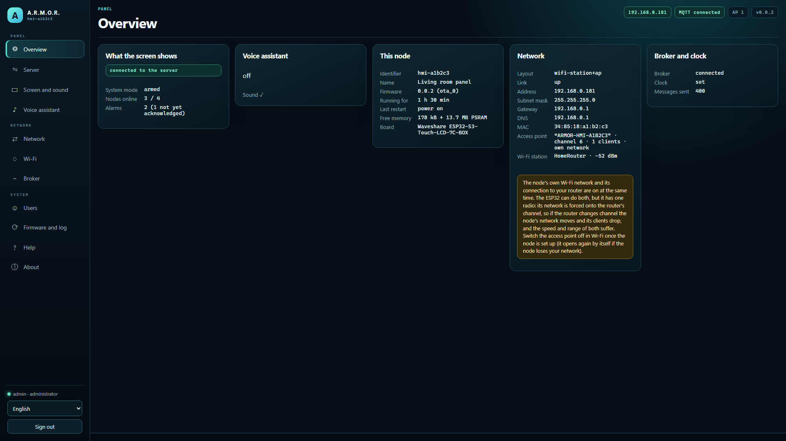
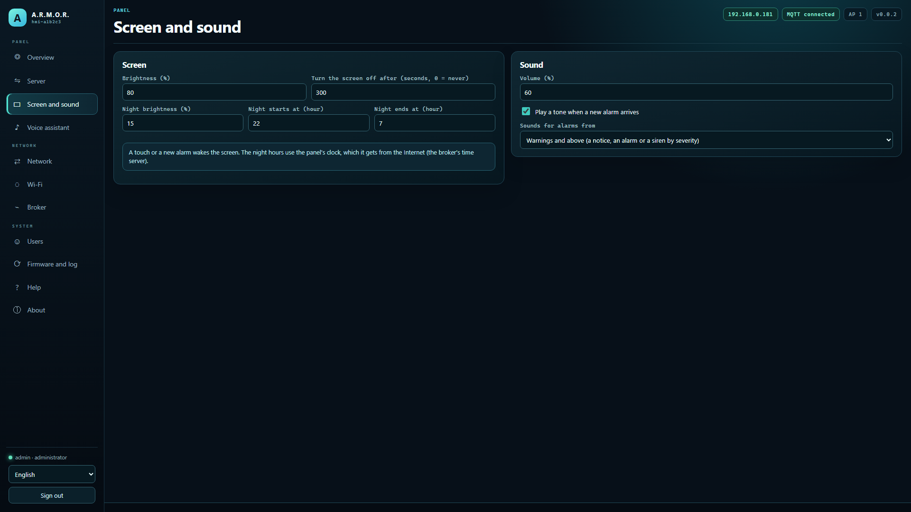
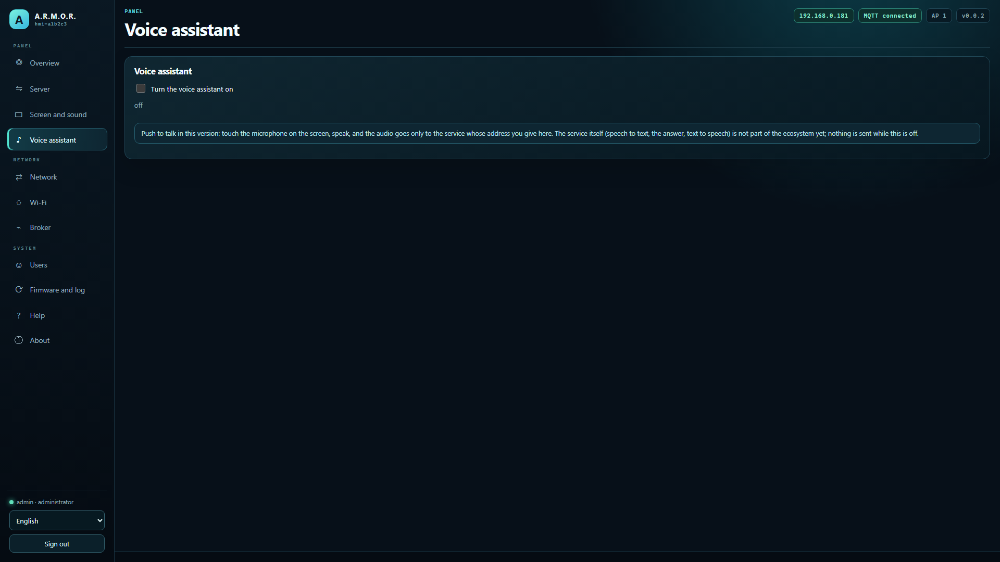
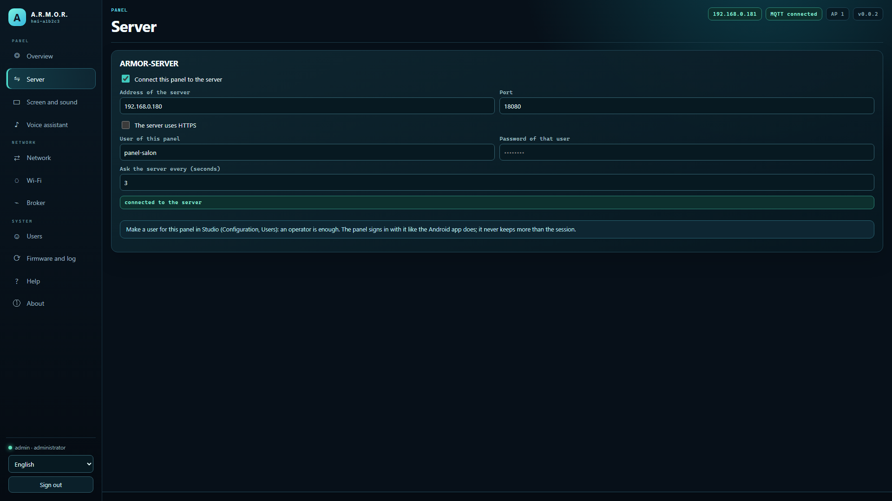

<p align="center">
  
</p>

# 🖥️ ARMOR-NODE-HMI

<p align="center">
  <a href="README.md">🇺🇸 English</a> |
  <a href="README_spa.md">🇪🇸 Español</a> |
  <a href="README_fra.md">🇫🇷 Français</a> |
  🇮🇹 <b>Italiano</b> |
  <a href="README_deu.md">🇩🇪 Deutsch</a> |
  <a href="README_zho.md">🇨🇳 简体中文</a> |
  <a href="README_jpn.md">🇯🇵 日本語</a> |
  <a href="README_por.md">🇵🇹 Português</a>
</p>

### Il pannello touch della casa: uno schermo da 7 pollici a parete che mostra lo stato del sistema, lo attiva e disattiva e riconosce gli allarmi, con microfono e altoparlante per l'assistente vocale che arriverà (un nodo della famiglia sull'ESP32-S3-Touch-LCD-7C-BOX, con la sua pagina web per le impostazioni)

<p align="center">
  
  
  
  
  
  
</p>

---

**Controllo di onestà - cosa funziona oggi:** Ciò che non dipende dalla scheda è reale e provato su un computer (le impostazioni, ciò che il pannello sa del server e quando è obsoleto, l'allarme di coercizione che non viene mai mostrato, la conversazione vocale e la lunga risposta del servizio vocale, i pin della scheda, i testi dello schermo in otto lingue e i glifi dei suoi caratteri, i controlli di versione e firma: 30,783 verifiche in 14 programmi di test) e lo è anche la pagina web (eseguita contro un sostituto in un browser reale). **Il firmware è stato compilato una volta (ESP-IDF 5.5.5, non verificato dall'integrazione continua) e non è mai girato su una scheda:** lo schermo, il touch, l'audio e il collegamento al server sono scritti dagli esempi di Waveshare per questa famiglia di schede e attendono la prima accensione. Il servizio vocale (ARMOR-VOICE-AI) risponde alle richieste di questo pannello; non c'è una parola di attivazione: si tocca per parlare.

---

## 📋 In breve

| | |
|---|---|
| Versione | `0.3.9` |
| Maturità | Funzionale |
| Test | 30.783 controlli in 14 programmi (`ctest`) |
| Tecnologia | C++17 (host-tested core); ESP-IDF firmware for the ESP32-S3 with LVGL, with its web page |
| Su hardware reale | Ancora nessuno: il firmware si compila (ESP-IDF 5.5.5, non verificato dalla CI) ma non è girato sulla scheda |

## 🚦 Stato del progetto

Ogni riga è una parte di questo repository e il semaforo dice a che punto è oggi. È scritta in base a ciò che il repository può mostrare (test, compilazioni, esecuzioni), non a ciò che è previsto.

🟢 Fatto e verificato · 🟡 Funziona, con limiti noti · 🟠 Fatto a metà o non ancora verificato · 🔴 Non fatto o non funzionante

| Area | Stato | Cosa significa qui |
|---|---|---|
| Software | 🟠 | Il firmware è stato compilato una volta (ESP-IDF 5.5.5), ma la compilazione non è controllata dall'integrazione continua e non ha mai girato su una scheda. |
| Test | 🟢 | Superano 30.783 controlli in 14 programmi host (`ctest`): le impostazioni, ciò che il pannello sa del server e quando è obsoleto, l'allarme sotto minaccia che non viene mai mostrato, lo scambio vocale, i pin, i testi dello schermo in otto lingue e i glifi dei suoi caratteri. |
| Protocolli e dati | 🟡 | Lo scambio con il server e con il servizio vocale ARMOR-VOICE-AI è provato contro simulazioni; è push to talk, senza parola di attivazione. |
| Interfaccia | 🟠 | La pagina web è stata eseguita contro una simulazione in un browser reale; lo schermo, il tocco e l'audio sono scritti dagli esempi di Waveshare e attendono la prima accensione. |
| Hardware | 🔴 | Il firmware non ha mai girato sulla scheda: nulla ha ancora funzionato su apparecchiature reali. |
| Sicurezza | 🟡 | Il codice di configurazione, il limite di accessi, il PIN Bluetooth, la gestione della minaccia e gli aggiornamenti firmati sono testati sull'host; non c'è stata una revisione indipendente. |
| Aggiornamenti | 🟠 | I controlli di hash e firma passano sull'host; un aggiornamento via etere non è mai stato eseguito su una scheda. |
| Integrazione | 🟡 | I messaggi sono validati contro gli schemi condivisi di ARMOR-COMMON; il collegamento con il server e con il servizio vocale non è stato provato da una scheda. |
| Documentazione | 🟢 | Otto lingue, la guida del firmware, le note di cablaggio e il registro delle modifiche sono aggiornati. |

## 🎯 Panoramica

* **Un client di ARMOR-SERVER, come l'app Android:** accede con un utente creato per lui da un amministratore, chiede `GET /api/v1/panel/summary` (poche centinaia di byte: la modalità, i nodi online e gli allarmi che richiedono una persona) ogni pochi secondi e, quando la persona tocca il pulsante e conferma, attiva, disattiva o riconosce. Se il server smette di rispondere, lo schermo dice che ciò che mostra è vecchio e il pulsante è disattivato. Ascolta il canale in diretta del server (un WebSocket) così un cambiamento si vede subito, e interroga come prima quando il canale manca, tace o è disattivato.
* **Lo schermo (800x480, LVGL):** la modalità nel colore del peggior allarme che nessuno ha visto, un grande pulsante attiva/disattiva con domanda prima, i nodi online, gli allarmi (quelli non visti per primi), una notte che lo attenua, un riposo dopo un tempo senza tocchi, un suono e un risveglio all'arrivo di un nuovo allarme, e otto lingue con accenti, giapponese e cinese disegnati con font generati per esattamente i caratteri usati.
* **Un nodo come gli altri:** la stessa memoria delle impostazioni, Wi-Fi, pagina web in otto lingue, configurazione Bluetooth dal telefono, aggiornamento del firmware con ripristino e HTTPS come ARMOR-NODE-RADAR, ARMOR-NODE-SOLAR e ARMOR-NODE-ELECTRICAL (condividono `ARMOR-COMMON/firmware_base`), più pagine per server, schermo, suono e voce; segnala a Studio di esistere via MQTT perché Studio lo elenchi con la sua pagina.
* **L'assistente vocale, premi per parlare:** un tocco apre il microfono, l'audio va solo al servizio vocale il cui indirizzo è nelle impostazioni (disattivato per impostazione predefinita), la risposta viene mostrata e detta; l'ordine dei passi, i limiti di tempo e ciò che fa un tocco sono una macchina a stati provata, e il pannello non esegue alcun comando da solo ([il contratto](docs/VOICE.md)). La registrazione parte come byte in una richiesta binaria e la risposta parlata torna come byte; a un server che non la accetta si invia la richiesta precedente.
* **La scheda:** Waveshare ESP32-S3-Touch-LCD-7C-BOX (32 MB di flash, 16 MB di PSRAM, schermo RGB da 7 pollici con tocco GT911, quattro microfoni, un altoparlante); i pin vengono dagli esempi di Waveshare e un test dimostra che due funzioni non condividono un GPIO ([la scheda](docs/HARDWARE.md)).
* **Aggiornamenti via etere firmati:** il nodo installa da GitHub solo un'immagine il cui SHA-256 coincide e che porta una firma Ed25519 valida del responsabile (la chiave pubblica è nel firmware, quella privata non lascia mai il responsabile); un file caricato a mano da un amministratore nel pannello resta accettato. Le pagine e i messaggi del pannello sono in otto lingue.
* **Abbinamento Bluetooth con PIN:** il PIN a sei cifre deriva dal codice di configurazione, è stampato sulla console USB e mostrato a un amministratore nel pannello; il telefono deve inserirlo prima di poter scrivere le impostazioni del nodo.
* **Non ancora:** una prima compilazione e accensione del firmware, una parola di attivazione, il servizio vocale sul Jetson e una vista delle telecamere sullo schermo.
* **Solo la casa può usare il pannello:** il pannello risponde per impostazione predefinita alla rete privata (o alle reti indicate dal proprietario, come una VPN), rifiuta un elenco che escluderebbe chi lo salva, conta le password errate per persona e per indirizzo e funziona dietro il proxy del server per essere raggiunto da fuori casa senza pubblicare il nodo.**Dice cosa succede:** lo schermo conosce il testo, in otto lingue, di ogni codice d'allarme che il server solleva (rete, solare, elettrico, zone d'allarme...) e dice al server di essere un pannello a parete, quindi viene elencato come tale e non conta come radar.
* **Collegamento cifrato facoltativo con il broker (TLS):** disattivato per impostazione predefinita, quindi il nodo parla MQTT non cifrato come prima. Un interruttore e una casella per il certificato dell'autorità propria dell'installazione (PEM, al massimo 2 KB) nella pagina Broker lo fanno collegare con `mqtts://`, fidarsi solo di quell'autorità e verificare che il certificato del broker sia stato fatto per l'indirizzo raggiunto; ciò che non è un solo certificato PEM viene rifiutato. Coperto da test sul computer; l'handshake non è ancora stato eseguito su una scheda.
* **Rapporto di salute:** circa una volta al minuto il nodo pubblica da quanto è acceso e perché si è riavviato l'ultima volta, la memoria libera, il collegamento e il segnale Wi-Fi, quante volte si è connesso al broker e l'ultimo errore registrato (`armor/health/<nodo>`, il contratto `node_health` di ARMOR-COMMON). Il codice che lo costruisce è condiviso da tutti i nodi e testato su un computer; non è mai girato su una scheda.
* **Controllo dal server:** Studio può riavviare il nodo in modo pulito, metterlo in pausa fino a un'ora (riprende da solo), mettere il suo lavoro in standby (senza fine, conservato ai riavvii, il nodo resta connesso e continua a rispondere), farlo mostrare, chiedere un'istantanea diagnostica e segnarlo in manutenzione (`armor/control/<nodo>/...`, il contratto `node_control` di ARMOR-COMMON). Ogni ordine è in due passi con un token monouso legato a quell'operazione, solo il server può scriverli sul broker e non esistono ripristino di fabbrica, cancellazione né sonno profondo. Finché il pannello è in pausa o in standby lo schermo mostra una schermata propria che lo dice e non accetta tocchi; quando gli si chiede di identificarsi, in alto lampeggia una barra (mai un suono). Il codice è condiviso da tutti i nodi e provato su un computer; non ha ancora girato su una scheda.
* **Diagnostica senza cavo:** dopo un avvio non pulito (un blocco, un watchdog, un calo di alimentazione, un'allocazione fallita) il rapporto di salute ne indica la causa per dieci minuti; un arresto anomalo lascia il suo core dump da vedere, scaricare o cancellare dal pannello; le impostazioni salvate vengono copiate prima di ogni installazione del firmware e recuperate se un aggiornamento le danneggia; e un amministratore può chiedere al nodo, tramite il server, un pacchetto di diagnostica o il suo registro con un token monouso.
* **Una sirena che si ripete e suoni in ordine:** ogni suono passa per una coda con priorità (sirena, allarme, voce, conferma, avviso); la sirena si ripete finché restano allarmi critici non riconosciuti (`audio.siren_repeat_s` 30, `audio.siren_max_repeats` 10) e gli allarmi mantengono un volume minimo (`audio.critical_min_volume` 40); la voce cede a un allarme.
* **Un orologio con batteria:** il chip PCF85063A della scheda dà l'ora all'avvio quando il nodo non ha ancora un'ora reale e il chip è affidabile, e viene corretto a ogni sincronizzazione o impostazione dell'ora (`time.rtc_enabled`, attivo per impostazione predefinita).
* **Lo stato di un comando, sullo schermo:** il piè di pagina dice che il comando è in invio finché è in viaggio e che è stato confermato per qualche secondo quando è andato a buon fine; un rifiuto vi mantiene il suo motivo, come prima.
* **Sigillatura facoltativa dei segreti salvati:** disattivata per impostazione predefinita (`security.seal_secrets`, o `nodes.nvs_encryption` del server). Attiva, le password, i token, le chiavi, i PIN e gli hash delle password che il nodo salva restano sigillati con ChaCha20-Poly1305 e tutto il resto resta leggibile; attivarla o disattivarla li riscrive senza perdere nulla, anche se il nodo si ferma a metà. Nessun eFuse viene bruciato e la flash non è cifrata: la chiave si trova in una partizione dello stesso chip, quindi **non** protegge da chi ha la scheda, e un nodo installato prima di quella partizione mantiene i suoi segreti com'erano finché non viene flashato con la nuova tabella delle partizioni.

## 🖼️ Schermate

Catturate a 1920×1080 su un banco di prova, con dati di esempio e senza alcuna installazione reale dietro.

<table>
<tr><td width="50%" valign="top"><br><sub>Riepilogo: lo stato del nodo in breve - rete, broker, firmware e ciò che riporta.</sub></td><td width="50%" valign="top"><br><sub>Schermo e suono: luminosità, ore notturne, volume e quali allarmi vengono annunciati.</sub></td></tr>
<tr><td width="50%" valign="top"><br><sub>Assistente vocale: premi per parlare, disattivato per impostazione predefinita, e il servizio a cui va il suo audio.</sub></td><td width="50%" valign="top"><br><sub>Server: l'indirizzo del server A.R.M.O.R., l'utente del pannello e ogni quanto interroga.</sub></td></tr>
</table>

## 🧩 Ruolo in A.R.M.O.R.

ARMOR-NODE-HMI è il pannello a muro: un client di [ARMOR-SERVER](https://github.com/JuanenRac/ARMOR-SERVER), come l'app Android, con uno schermo da 7 pollici, un microfono e un altoparlante. Mostra la modalità, i nodi online e gli allarmi che richiedono una persona, inserisce e disinserisce (con il PIN) e riconosce gli allarmi. È dove vivrà l'assistente vocale ([ARMOR-VOICE-AI](https://github.com/JuanenRac/ARMOR-VOICE-AI)) quando esisterà il suo servizio vocale e, come ogni nodo, si configura e si aggiorna da [ARMOR-STUDIO](https://github.com/JuanenRac/ARMOR-STUDIO).

## 📂 Struttura del repository

```text
ARMOR-NODE-HMI/
├── main/    the ESP-IDF component: app_main, display (RGB panel, GT911, LVGL), ui (the screen), audio (I2S, ES7210, ES8389), voice, server_link (HTTP to ARMOR-SERVER), board_io (I2C and the expander),
│            network, web_server, api_shared, mqtt_link, node_store, tls_cert, ble_provision (the shared node firmware), fonts/ (generated)
├── core/    hmi_config (the settings), server_view (the summary, the link, what is new), voice_session (the conversation), screen_text (eight languages), board_s3 (the pins), auth, netplan, json...
├── panel/   the web page: index.html, app.js, text.js (8 languages), style.css
├── tests/   test_config, test_mqtt_tls, test_view, test_voice, test_voice_binary, test_live, test_board
├── tools/   build_node.sh, check_sdkconfig.py, make_fonts.py, pack_panel.py, panel_mock.mjs, panel_browser_test.mjs, the shared CI checks (armor_ci_validate.py, armor_project_tool.py, _armor_readme_parity.py)
├── secrets/ node.conf.example (the real files are git-ignored)
├── CMakeLists.txt, partitions.csv, sdkconfig.defaults, sdkconfig.board.lcd7box, dependencies.lock   the ESP-IDF project, the flash layout, the settings of the board and the pinned components
├── docs/    DESIGN, HARDWARE, VOICE, NODE_FIRMWARE, FONTS, BLE_PROVISIONING, FIRMWARE_BUILD_ACTIONS, BENCH_TESTS, SETUP_CODE
└── images/  brand assets
```

## 🛠️ Ambiente di sviluppo

**Requisiti:** un compilatore C++17 per i test sul computer, il container ESP-IDF 5.5.5 per compilare l'immagine, un Waveshare ESP32-S3-Touch-LCD-7C-BOX

```bash
cmake -S tests -B build/host && cmake --build build/host && ctest --test-dir build/host   # the settings, the server view, the voice conversation, the board's pins and the screen's words
node tools/panel_mock.mjs --user admin:adminpass123                                       # the web page without a board
node tools/panel_browser_test.mjs                                                         # the page in a real browser, every page in eight languages
tools/build_node.sh generic                                                               # the firmware image in the ESP-IDF container: dist/generic-lcd7box.bin (never built yet)
```

See the [firmware guide](docs/NODE_FIRMWARE.md) and the [Bluetooth channel](docs/BLE_PROVISIONING.md).

Vedi la [progettazione](docs/DESIGN.md), la [scheda](docs/HARDWARE.md), l'[assistente vocale](docs/VOICE.md), la [guida al firmware](docs/NODE_FIRMWARE.md) e i [font](docs/FONTS.md).

Per compilare il firmware a mano in GitHub Actions, vedi [compilare in GitHub Actions](docs/FIRMWARE_BUILD_ACTIONS.md).

## 🔗 Progetti correlati

**A.R.M.O.R.** (Autonomous Radar & Multimodal Observation Range) è un sistema di sicurezza perimetrale fatto di repository indipendenti. Ognuno ha la propria versione, i propri test e il proprio README; ecco la famiglia:

* **[ARMOR-COMMON](https://github.com/JuanenRac/ARMOR-COMMON)** - Contratti dei messaggi, validatori, vettori di conformità e tipi generati
* **[ARMOR-NODE-RADAR](https://github.com/JuanenRac/ARMOR-NODE-RADAR)** - Firmware del nodo di campo per ESP32-S3 con tre radar e un proprio pannello web
* **[ARMOR-NODE-SOLAR](https://github.com/JuanenRac/ARMOR-NODE-SOLAR)** - Protocolli di inverter e batterie solari e messaggi di un nodo gateway
* **[ARMOR-NODE-ELECTRICAL](https://github.com/JuanenRac/ARMOR-NODE-ELECTRICAL)** - Nodo elettrico: contatori, il messaggio delle letture della rete e le regole di manovra
* **[ARMOR-NODE-ALARM](https://github.com/JuanenRac/ARMOR-NODE-ALARM)** - Nodo e centrale d'allarme: zone, inserimento, ritardi, sirena e PIN, con il server o senza
* **ARMOR-NODE-HMI** (questo repository) - Pannello touch: lo stato del sistema su uno schermo a parete, attivare e riconoscere gli allarmi, e la casa dell'assistente vocale
* **[ARMOR-NETWORK](https://github.com/JuanenRac/ARMOR-NETWORK)** - La rete locale: i suoi dispositivi, internet e ciò che cambia
* **[ARMOR-SERVER](https://github.com/JuanenRac/ARMOR-SERVER)** - Coordinatore centrale: telemetria, allarmi, dispositivi, letture solari e telecamere
* **[ARMOR-STUDIO](https://github.com/JuanenRac/ARMOR-STUDIO)** - Console web: telecamere, radar, allarmi, energia solare e progettista del sito 2D/3D
* **[ARMOR-ANDROID-CONTROL](https://github.com/JuanenRac/ARMOR-ANDROID-CONTROL)** - Client Android dell'operatore con radar 2D/3D in tempo reale
* **[ARMOR-IOS-CONTROL](https://github.com/JuanenRac/ARMOR-IOS-CONTROL)** - Client operatore per iPhone
* **[ARMOR-SERVER-AI](https://github.com/JuanenRac/ARMOR-SERVER-AI)** - Politica di inferenza visiva che spiega le sue decisioni e non agisce mai
* **[ARMOR-VISION](https://github.com/JuanenRac/ARMOR-VISION)** - Zone delle telecamere, maschere e regole di rilevamento per la Jetson Orin NX
* **[ARMOR-VOICE-AI](https://github.com/JuanenRac/ARMOR-VOICE-AI)** - Intenti vocali offline con una conferma impossibile da falsificare
* **[ARMOR-HARDWARE](https://github.com/JuanenRac/ARMOR-HARDWARE)** - Contenitori, elettronica e matrice di accettazione da banco
* **[ARMOR-DEVOPS](https://github.com/JuanenRac/ARMOR-DEVOPS)** - Distribuzione, banco di prova CM5, backup e TLS
* **[ARMOR-SIMULATOR](https://github.com/JuanenRac/ARMOR-SIMULATOR)** - Simulatore di telemetria offline con guasti ripetibili
* **[ARMOR-UPDATER](https://github.com/JuanenRac/ARMOR-UPDATER)** - Rileva, installa e aggiorna i repository stessi dell'ecosistema
* **[ARMOR-DOCS](https://github.com/JuanenRac/ARMOR-DOCS)** - Architettura, base di sicurezza e matrice delle capacità

## 📚 Documentazione e comunità

Dove leggere di più:

* [Matrice delle capacità: cosa è provato e cosa no](https://github.com/JuanenRac/ARMOR-DOCS/blob/main/docs/CAPABILITY_MATRIX.md)
* [Catalogo dei progetti: versioni e dipendenze tra i repository](https://github.com/JuanenRac/ARMOR-DOCS/blob/main/docs/PROJECT_CATALOG.md)
* [Cronologia delle modifiche di questo repository](CHANGELOG.md)
* [Licenza (GPL-3.0-or-later)](LICENSE)
* Domande, idee e segnalazioni: electrohobby3d@gmail.com

## 👤 AUTORE

**JuanenRac (Electro Hobby 3D)** · electrohobby3d@gmail.com

## 📜 LICENZA

GPL-3.0-or-later - vedi [LICENSE](LICENSE).
