<p align="center">
  
</p>

# 🖥️ ARMOR-HMI

<p align="center">
  <a href="README.md">🇺🇸 English</a> |
  <a href="README_spa.md">🇪🇸 Español</a> |
  <a href="README_fra.md">🇫🇷 Français</a> |
  <a href="README_ita.md">🇮🇹 Italiano</a> |
  <a href="README_deu.md">🇩🇪 Deutsch</a> |
  <a href="README_zho.md">🇨🇳 简体中文</a> |
  <a href="README_jpn.md">🇯🇵 日本語</a> |
  <a href="README_por.md">🇵🇹 Português</a>
</p>


### O painel tátil da casa: um ecrã de 7 polegadas na parede que mostra o estado do sistema, arma e desarma e reconhece alarmes, com um microfone e um altifalante para o assistente de voz que virá (um nó da família na ESP32-S3-Touch-LCD-7C-BOX, com a sua própria página web para as definições)

<p align="center">
  
  
  
  
  
</p>

---

**Verificação de honestidade - o que funciona hoje:** **Maturidade: andaime.** O que não depende da placa é real e está testado num computador (as definições, o que o painel sabe do servidor e quando isso está desatualizado, a conversa de voz, os pinos da placa e as palavras do ecrã em sete idiomas: quatro programas de teste) e a página web também (executada contra um substituto num navegador real). **O firmware nunca foi compilado nem executado numa placa:** o ecrã, o toque, o som e a ligação ao servidor estão escritos a partir dos exemplos da Waveshare para esta família de placas e precisam da sua primeira compilação e do seu primeiro arranque. O serviço de fala com que o assistente fala ainda não existe e não há palavra de ativação: é premir para falar.

---

## 🎯 Visão geral

* **Um cliente do ARMOR-SERVER, como a aplicação Android:** inicia sessão com um utilizador que um administrador criou para ele, pede `GET /api/v1/panel/summary` (algumas centenas de bytes: o modo, os nós ligados e os alarmes que precisam de uma pessoa) a cada poucos segundos e, quando a pessoa toca no botão e confirma, arma, desarma ou reconhece. Se o servidor deixa de responder, o ecrã diz que o que mostra é antigo e o botão fica desativado.
* **O ecrã (800x480, LVGL):** o modo na cor do pior alarme que ninguém viu, um grande botão de armar/desarmar com uma pergunta primeiro, os nós ligados, os alarmes (os não vistos primeiro), uma noite que o escurece, um repouso após algum tempo sem toques, um som e um despertar quando chega um alarme novo, e sete idiomas com acentos, japonês e chinês desenhados com tipos de letra gerados exatamente para os carateres usados.
* **Um nó como os outros:** o mesmo armazenamento de definições, Wi-Fi, página web em sete idiomas, configuração por Bluetooth a partir do telemóvel, atualização de firmware com retrocesso e HTTPS como o ARMOR-RADAR, o ARMOR-SOLAR e o ARMOR-ELECTRICAL (partilham `ARMOR-COMMON/firmware_base`), mais páginas para o servidor, o ecrã, o som e a voz; diz ao Studio que existe por MQTT para que o Studio o liste com a sua página.
* **O assistente de voz, premir para falar:** um toque abre o microfone, o áudio vai só para o serviço de fala cujo endereço está nas definições (desativado por omissão), a resposta mostra-se e diz-se em voz alta; a ordem dos passos, os limites de tempo e o que faz um toque são uma máquina de estados testada, e o painel não executa nenhum comando por si só ([o contrato](docs/VOICE.md)).
* **A placa:** Waveshare ESP32-S3-Touch-LCD-7C-BOX (32 MB de flash, 16 MB de PSRAM, um ecrã RGB de 7 polegadas com toque GT911, quatro microfones, um altifalante); os pinos vêm dos exemplos da Waveshare e um teste prova que nenhumas duas funções partilham um GPIO ([a placa](docs/HARDWARE.md)).
* **Ainda não:** uma primeira compilação e arranque do firmware, uma palavra de ativação, o serviço de fala no Jetson, e uma vista das câmaras no ecrã.

## 📂 Estrutura do repositório

```text
ARMOR-HMI/
├── main/    the ESP-IDF component: app_main, display (RGB panel, GT911, LVGL), ui (the screen), audio (I2S, ES7210, ES8389), voice, server_link (HTTP to ARMOR-SERVER), board_io (I2C and the expander),
│            network, web_server, api_shared, mqtt_link, node_store, tls_cert, ble_provision (the shared node firmware), fonts/ (generated)
├── core/    hmi_config (the settings), server_view (the summary, the link, what is new), voice_session (the conversation), screen_text (seven languages), board_s3 (the pins), auth, netplan, json...
├── panel/   the web page: index.html, app.js, text.js (7 languages), style.css
├── tests/   test_config, test_view, test_voice, test_board
├── tools/   build_node.sh, make_fonts.py, pack_panel.py, panel_mock.mjs, panel_browser_test.mjs
├── docs/    DESIGN, HARDWARE, VOICE, NODE_FIRMWARE, FONTS, BLE_PROVISIONING
└── images/  brand assets
```

## 🛠️ Ambiente de desenvolvimento

```bash
cmake -S tests -B build/host && cmake --build build/host && ctest --test-dir build/host   # the settings, the server view, the voice conversation, the board's pins and the screen's words
node tools/panel_mock.mjs --user admin:adminpass123                                       # the web page without a board
node tools/panel_browser_test.mjs                                                         # the page in a real browser, every page in seven languages
tools/build_node.sh generic                                                               # the firmware image in the ESP-IDF container: dist/generic-lcd7box.bin (never built yet)
```

Veja o [guia do firmware](docs/NODE_FIRMWARE.md) e o [canal Bluetooth](docs/BLE_PROVISIONING.md).

Veja o [desenho](docs/DESIGN.md), a [placa](docs/HARDWARE.md), o [assistente de voz](docs/VOICE.md), o [guia do firmware](docs/NODE_FIRMWARE.md) e os [tipos de letra](docs/FONTS.md).

## 🔗 Projetos relacionados

O **A.R.M.O.R.** (Autonomous Radar & Multimodal Observation Range) é um sistema de segurança perimetral feito de repositórios independentes. Cada um tem a sua própria versão, os seus próprios testes e o seu próprio README; esta é a família:

* **[ARMOR-COMMON](https://github.com/JuanenRac/ARMOR-COMMON)** - Contratos de mensagens, validadores, vetores de conformidade e tipos gerados
* **[ARMOR-RADAR](https://github.com/JuanenRac/ARMOR-RADAR)** - Firmware de nó de campo para ESP32-S3 com três radares e o seu próprio painel web
* **[ARMOR-SOLAR](https://github.com/JuanenRac/ARMOR-SOLAR)** - Protocolos de inversores e baterias solares e as mensagens de um nó de ligação
* **[ARMOR-ELECTRICAL](https://github.com/JuanenRac/ARMOR-ELECTRICAL)** - Nó elétrico: contadores, a mensagem das leituras da rede e as regras de comutação
* **ARMOR-HMI** (este repositório) - Painel tátil: o estado do sistema num ecrã de parede, armar e reconhecer, e a casa do assistente de voz
* **[ARMOR-NETWORK](https://github.com/JuanenRac/ARMOR-NETWORK)** - A rede local: os seus dispositivos, a internet e o que muda
* **[ARMOR-SERVER](https://github.com/JuanenRac/ARMOR-SERVER)** - Coordenador central: telemetria, alarmes, dispositivos, leituras solares e câmaras
* **[ARMOR-STUDIO](https://github.com/JuanenRac/ARMOR-STUDIO)** - Consola web: câmaras, radar, alarmes, energia solar e o desenhador de local 2D/3D
* **[ARMOR-ANDROID-CONTROL](https://github.com/JuanenRac/ARMOR-ANDROID-CONTROL)** - Cliente Android de operador com um radar 2D/3D em direto
* **[ARMOR-SERVER-AI](https://github.com/JuanenRac/ARMOR-SERVER-AI)** - Política de inferência visual que explica as suas decisões e nunca atua
* **[ARMOR-VOICE-AI](https://github.com/JuanenRac/ARMOR-VOICE-AI)** - Intenções de voz offline com uma confirmação que não se pode falsificar
* **[ARMOR-HARDWARE](https://github.com/JuanenRac/ARMOR-HARDWARE)** - Caixas, eletrónica e a matriz de aceitação de bancada
* **[ARMOR-DEVOPS](https://github.com/JuanenRac/ARMOR-DEVOPS)** - Implementação, a bancada de testes CM5, cópias de segurança e TLS
* **[ARMOR-SIMULATOR](https://github.com/JuanenRac/ARMOR-SIMULATOR)** - Simulador de telemetria offline com falhas repetíveis
* **[ARMOR-UPDATER](https://github.com/JuanenRac/ARMOR-UPDATER)** - Deteta, instala e atualiza os próprios repositórios do ecossistema
* **[ARMOR-DOCS](https://github.com/JuanenRac/ARMOR-DOCS)** - Arquitetura, linha de base de segurança e a matriz de capacidades

## 📚 Documentação e comunidade

Onde ler mais:

* [Matriz de capacidades: o que está provado e o que não](https://github.com/JuanenRac/ARMOR-DOCS/blob/main/docs/CAPABILITY_MATRIX.md)
* [Catálogo de projetos: versões e como os repositórios dependem uns dos outros](https://github.com/JuanenRac/ARMOR-DOCS/blob/main/docs/PROJECT_CATALOG.md)
* [Registo de alterações deste repositório](CHANGELOG.md)
* [Licença (GPL-3.0-or-later)](LICENSE)
* Perguntas, ideias e relatórios: electrohobby3d@gmail.com

## 👤 AUTOR

**JuanenRac (Electro Hobby 3D)** · electrohobby3d@gmail.com

## 📜 LICENÇA

GPL-3.0-or-later - veja [LICENSE](LICENSE).
